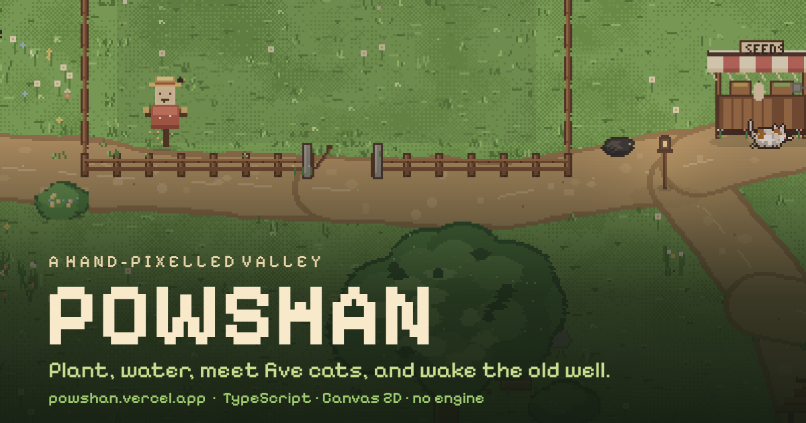

# Powshan

A small, hand-pixelled farming game about coming home. Keep a wild field, meet six cats, and wake the old well.

**Play it: [powshan.vercel.app](https://powshan.vercel.app/)**



## The valley

You inherit a cottage at the edge of a meadow. Sean and Powi came with you; the rest of the valley is still something you have only heard about. The field is overgrown, the well is dry, and four more cats keep their own hours out there.

Name your farmer, choose a boy or girl, and take the day at your own pace. There is no timer and no wrong way to keep a day.

## The cats

- **Sean** — the very cuddly one. Leans into your hand before you reach him.
- **Powi** — sleepy and shy. Warms up if you sit still nearby.
- **Uling** — all energy, all alone. Keeps his distance, then sprints off.
- **Adidas** — cuddly on her own terms. Decides when a pat is allowed.
- **Mingkay** — the all-rounder. Follows for a while, then finds a sunbeam.
- **Mumu** — white with a dark saddle and a black tail. Easy to call, always happy to approach, never happy to be touched.

Press **C** to call. Each cat decides whether the whistle is worth getting up for. Mumu almost always thinks it is — then slips out from under your hand when you reach for her.

## What to do

1. Hoe patches inside the fenced field.
2. Buy seeds from the honesty stand and plant them.
3. Water them, sleep at the cottage door, and harvest.
4. Meet the neighbours and let the shy ones come to you.
5. Grow moonflowers and offer three blooms at the old well.

## Controls

| Key | Action |
| --- | --- |
| `WASD` / arrows | walk |
| `Shift` | run |
| `Space` / `F` / click | use the selected tool |
| `1`–`6` | select a hotbar slot |
| `E` / right click | talk, read, shop, sleep |
| `C` | call the cats |
| `J` / `Tab` | field notes |
| `Esc` | pause |
| `M` | mute |

Touch gets a floating stick and Use / Talk / Call buttons. Portrait phones are asked to turn sideways.

## Development

```bash
npm install
npm run dev      # http://127.0.0.1:5173
npm test         # simulation and cat/save tests
npm run build    # typecheck + production bundle in dist/
```

The game is written in TypeScript and rendered with Canvas 2D at a 480×270 internal resolution. There are no runtime dependencies and no external art packs; the valley, the farmer, the cats and the props are all drawn in code.

```
src/
  core/      canvas helpers, input, fixed-step loop, rng, audio
  data/      crops, cats
  render/    palette and every sprite/terrain painter
  systems/   time, farm, quests, save
  ui/        DOM HUD, journal, shop, dialogs
  world/     layout, collision, interact points
  game/      the Game class: update, draw order, actions
tests/       vitest coverage for the pure simulation
legacy-2d/   the original prototype, kept for reference
```

Vercel builds with `npm run build` and serves `dist/` (see `vercel.json`).

Made by [vyn-7](https://github.com/vyn-7). The cats are real; the valley is drawn from scratch.
